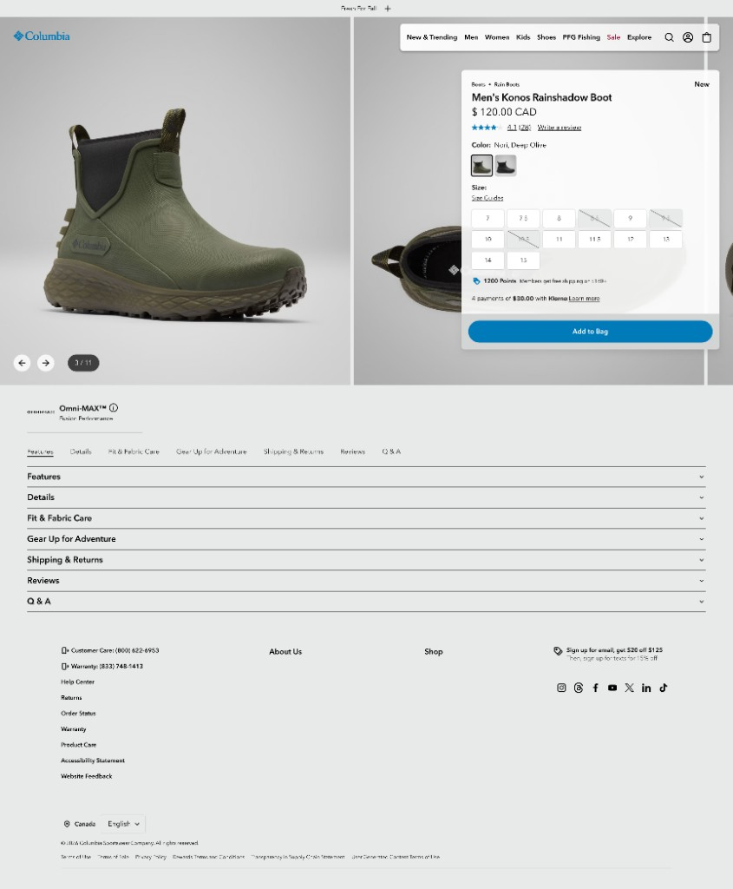

# Product page: Trail Runner 2

A product page for our new trail running shoe, Trail Runner 2, on the Stride online store. The store is already a React app with a homepage that links to `/products/trail-runner-2`; build the product page at that address, using mock data, and don't add any packages to the app beyond React and its build tool. For the look, you can take inspiration from this design:

- **Store:** the shopper sees the store name and how many items are in their cart.
- **Path:** the shopper sees where the shoe sits in the store, such as Shop, Trail, Trail Runner 2, and can go back to any earlier step.
- **Photos:** the shopper sees one photo of the shoe at a time and can move to the next or previous one, going back to the first after the last.
- **Price:** the shopper sees the price and can point at a small "i" next to it to learn that it includes taxes.
- **Color:** the shopper can choose blue, black or grey; only the chosen color shows until they change it, each with a round swatch.
- **Size:** the shopper picks one size from a list that only opens when they want to change it; only the chosen size shows, and sold-out sizes can't be picked.
- **Size guide:** the shopper can open a size chart over the page from next to the size, enter their foot length and choose US or EU to get their size, and must close it to continue.
- **Quantity:** the shopper can choose how many pairs to buy, typing the number or changing it by one.
- **Add to cart:** the shopper adds the shoe to the cart and sees a confirmation; without a size they are asked to pick one.
- **Wishlist:** the shopper can save or unsave the shoe with a heart.
- **More information:** details, reviews and shipping sit side by side below everything, with one section shown at a time.
- **Questions:** a few common questions about the shoe, each with its answer hidden until the shopper opens it.
- **Bottom of the page:** the shopper finds customer help, company and social media links.
